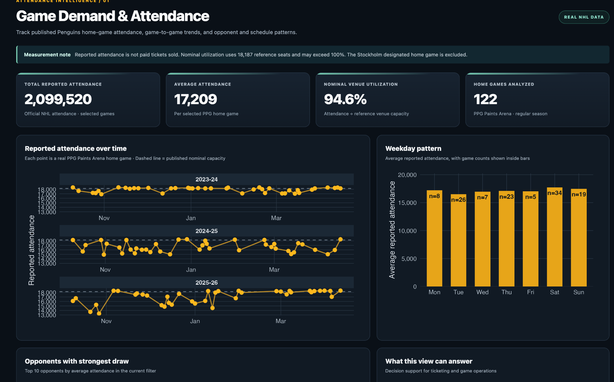
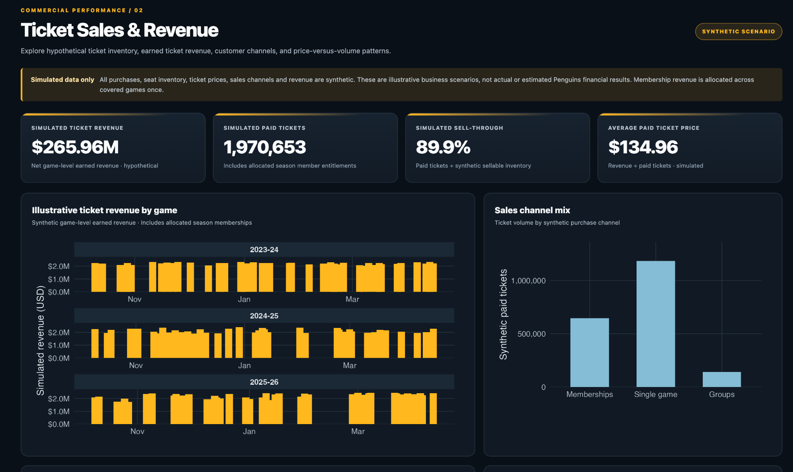
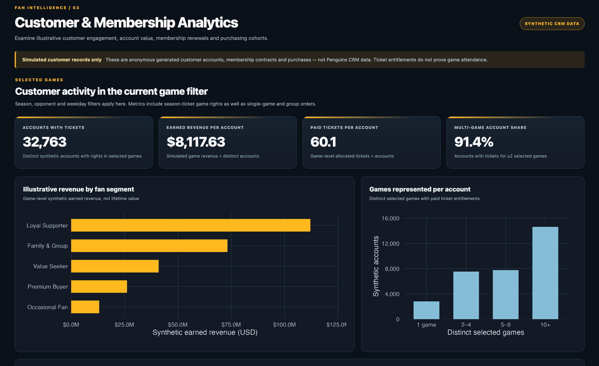
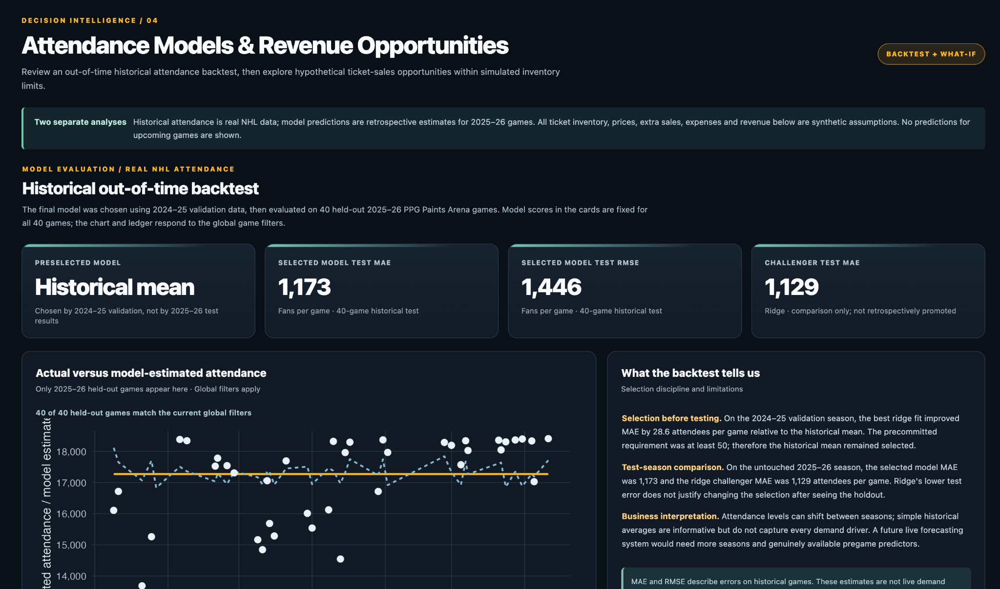
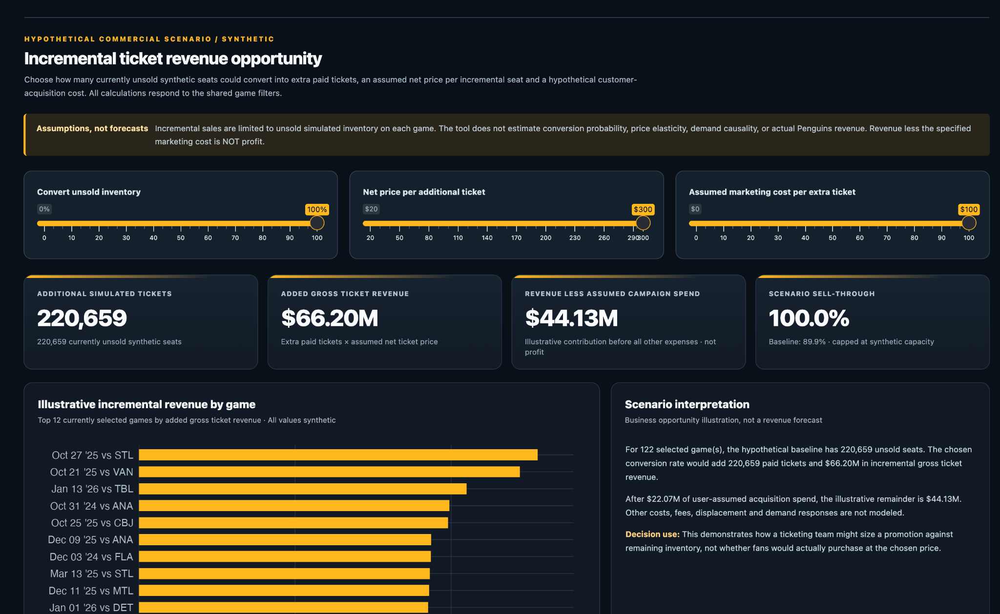

# Pittsburgh Penguins Ticketing & Fan Revenue Analytics HUB

**R Shiny | Sports business intelligence | Attendance modeling | Synthetic ticketing & CRM analytics**

An interactive sports business analytics portfolio project built to demonstrate how a hockey organization's ticket sales, marketing, CRM, and business operations teams could analyze demand, inventory, customer retention, and potential revenue opportunities.

> **Independent educational portfolio — not affiliated with, endorsed by, or operated by the Pittsburgh Penguins, PPG Paints Arena, or the NHL.** Game dates, opponents, results, venues and reported attendance are based on publicly available **real NHL game data**. **All ticket transactions, customers, memberships, seat allocations, financial metrics and revenue scenarios are synthetic**; they are not actual or estimated Penguins business results.

**Status:** Local Shiny dashboards and data/model audits passed. Public Shiny deployment is planned for Stage 6B; a live app URL has **not** been published here yet.

## Inside the dashboard

| Dashboard | Provenance | Business questions |
|---|---|---|
| **Attendance & Demand** | Real NHL game reports | Which games, opponents, and weekdays drew higher attendance? |
| **Ticket Sales & Revenue** | Synthetic | How do price, paid volume, seat class and channel affect earned ticket revenue? |
| **Customer & Membership** | Synthetic | What patterns appear in repeat purchasing, segment value and membership renewal? |
| **Forecasting & Opportunities** | Real historical attendance for backtest; synthetic for what-if | How well did retrospective models predict a held-out season? How does assumed conversion of unsold inventory change hypothetical revenue? |

### Attendance & Demand — actual published attendance



### Ticket Sales & Revenue — synthetic financial scenario



### Customer & Membership — synthetic CRM scenario



### Attendance backtest — retrospective model evaluation



### Revenue opportunity calculator — user-controlled hypothetical assumptions



## Scope and verified development results

- **2023–24, 2024–25, 2025–26:** three completed NHL regular seasons.
- **123** designated Pittsburgh home games in the source table; **122** actually played at PPG Paints Arena. Pittsburgh's November 16, 2025 designated home game against Nashville took place in **Stockholm** and is excluded from PPG-specific charts.
- **2,099,520** reported arena attendance across 122 games; mean **17,209** and **94.6%** of the nominal 18,187-seat reference capacity. This capacity is not game-by-game saleable inventory; reported attendance may exceed nominal seating capacity.
- Reproducible synthetic simulation: **35,000 customers**, **7,458 membership records**, **432,205 order headers**, **727,847 ticket-order lines**, and **488 game × seat-category records**.
- Stage 2, 3, 4B, 5A, and 5B data/model acceptance checks passed in the author's local RStudio environment. Counts are historical development evidence, **not** assertions that a fresh clone contains generated datasets.

## Historical attendance modeling

The forecasting component is a **historical out-of-time backtest**, not a live prediction of future hockey attendance.

| Split | NHL season | PPG games | Purpose |
|---|---|---:|---|
| Training | 2023–24 | 41 | Train model candidates |
| Validation | 2024–25 | 41 | Choose ridge penalty and final model |
| Final holdout | 2025–26 | 40 | Evaluate once after model selection |

The project compares a historical-attendance mean against a regularized ridge regression using pregame calendar and schedule features. A prespecified selection rule required ridge to improve validation MAE by **at least 50 fans per game**. The best ridge model improved validation MAE by only **28.6**, so **the historical mean remained selected before the holdout was evaluated**.

| 2025–26 historical holdout | Selected historical mean | Ridge challenger |
|---|---:|---:|
| MAE, attendees/game | **1,172.6** | 1,128.6 |
| RMSE, attendees/game | **1,445.7** | 1,385.5 |
| Bias, predicted minus actual | +191.0 | +241.6 |

Ridge achieved lower final test error, but the project deliberately **does not retrospectively change the selected model**. The 40-game holdout is too small to establish long-run future performance, and synthetic financial data were not used as model predictors.

Read [the model card](docs/stage5a_model_card.md) and [the Stage 5B methodology](docs/stage5b_methodology.md).

## Synthetic revenue opportunity model

The what-if dashboard lets users choose a **hypothetical** conversion rate for simulated unsold seats, an assumed net price for incremental tickets, and an assumed customer-acquisition cost per incremental ticket.

- Additional ticket count is constrained by unsold **synthetic** seat inventory **per game**.
- Added revenue = additional hypothetical paid tickets × user-assumed price.
- Revenue less user-assumed acquisition spend **is not operating profit**.
- The simulator does **not** forecast conversion, price elasticity, ticket demand, actual Penguins revenue, or the effect of promotions on attendance.

Example local default: 15% conversion, $90 per additional ticket, $10 assumed acquisition spend per ticket produced **33,041 hypothetical additional tickets** and **$2,973,690** illustrative added gross ticket revenue across the 122-game simulated dataset. These values are generated, not observed commercial outcomes.

## Tech stack

- **R, RStudio, tidyverse (dplyr), ggplot2** for data preparation and analysis
- **Shiny, bslib, DT, CSS** for the responsive application
- **httr2, rvest, jsonlite** for public NHL data acquisition
- **Base R ridge regression helpers** for regularized modeling, with versioned scripts and independent validation checks
- **Git and GitHub** for source control; **shinyapps.io** deployment planned for Stage 6B

## Repository layout

```text
Penguins-Ticketing-HUB/
├── app.R                      # Main Shiny entry point
├── R/                         # API, simulation, modeling and Shiny helpers/modules
├── scripts/                   # Numbered build, model, audit and publication checks
├── www/                       # App styling: styles.css, stage4b.css, stage5b.css
├── docs/                      # Data dictionaries, methodology, demos, screenshots
├── data/                      # Generated locally, intentionally Git-ignored
├── models/                    # Fitted artifacts, intentionally Git-ignored
└── outputs/                   # Generated reports/plots, intentionally Git-ignored
```

The repository deliberately tracks **code and documentation**, not local NHL HTML/JSON caches, synthetic customer records, large RDS files, or trained model binaries. Local `.gitignore` rules **do not delete** your existing files. A fresh clone must execute the numbered scripts to recreate the runtime datasets.

## Reproduce in RStudio

1. Clone the repository, open `Penguins-Ticketing-HUB.Rproj` or create a project at the repository root, and install required packages with:

   ```r
   source("scripts/00_install_packages.R")
   source("scripts/07_install_shiny_packages.R")
   ```

2. Build and validate real NHL history:

   ```r
   source("scripts/01_build_games_real.R")
   source("scripts/02_validate_games_real.R")
   source("scripts/03_preview_attendance.R")
   ```

3. Build and validate **synthetic** customers, orders and memberships:

   ```r
   source("scripts/04_build_synthetic_ticketing.R")
   source("scripts/05_validate_synthetic_ticketing.R")
   source("scripts/06_preview_synthetic_kpis.R")
   ```

4. Validate the revenue and customer inputs:

   ```r
   source("scripts/08_check_shiny_inputs.R")
   source("scripts/09_check_customer_inputs.R")
   ```

5. Train, evaluate and audit the **historical attendance backtest**:

   ```r
   source("scripts/10_prepare_attendance_features.R")
   source("scripts/11_train_attendance_models.R")
   source("scripts/12_diagnose_attendance_models.R")
   source("scripts/13_validate_attendance_models.R")
   ```

6. Validate the combined app and launch:

   ```r
   source("scripts/14_check_forecast_dashboard.R")
   source("scripts/15_check_git_publication.R")
   shiny::runApp()
   ```

The NHL endpoints require internet access. Audit scripts intentionally stop rather than silently substituting invented attendance. Synthetic outputs are generated reproducibly from fixed seeds. Refer to [the data sources](docs/data_sources_and_ethics.md) and [full reproducibility notes](docs/reproducibility.md) for caveats.

## Key safeguards

- Real NHL attendance is **not** synonymous with paid ticket sales or turnstile scans.
- Simulated season-ticket purchase value is allocated across home games once; revenue and entitlements are not counted twice.
- Customer identifiers represent **anonymous synthetic accounts**, not real fans.
- Reported attendance is **never imputed with simulated values**.
- Model selection is determined on validation, not changed after viewing the 2025–26 holdout.
- Source attribution and REAL/SYNTHETIC labels remain visible across dashboards and CSV exports.

## Documentation

- [Data sources & ethics](docs/data_sources_and_ethics.md)
- [Reproducing generated files](docs/reproducibility.md)
- [Historical model card](docs/stage5a_model_card.md)
- [Customer KPI definitions](docs/stage4b_customer_kpi_dictionary.md)
- [Dashboard metric definitions](docs/stage4a_kpi_definitions.md)
- [Stage 6A GitHub publication guide](docs/stage6a_publication_playbook.md)

## Project status and contact

The analytics application is **working locally**. A public shinyapps.io link will be added after deployment and verification in Stage 6B. Portfolio website integration is handled separately.

Author: [CamdenWade](https://github.com/CamdenWade). This repository is an independent educational portfolio and is not affiliated with the Pittsburgh Penguins or NHL. No reuse license has been selected yet; public viewing does not by itself grant permission to reuse the code.
